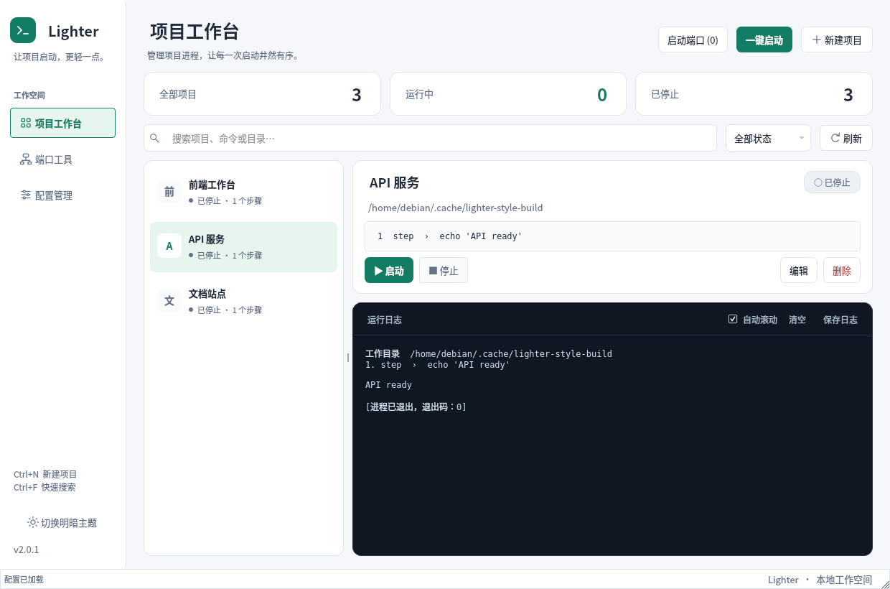
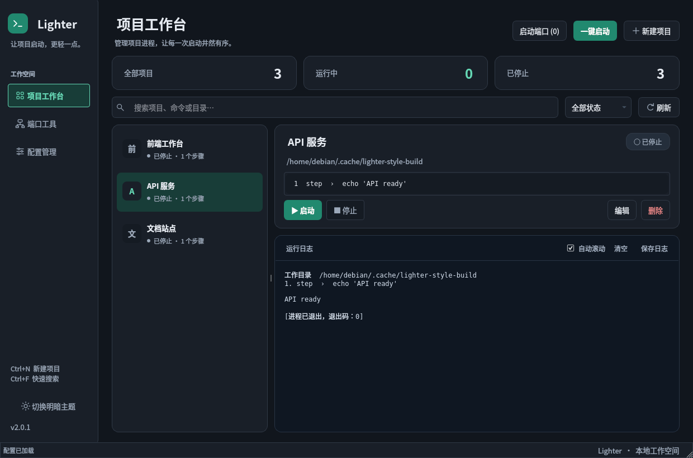

# Lighter 界面设计

## 产品与风格

当前维护的是 `native/` 中的 Qt 6 Widgets 桌面应用，`legacy/tauri/` 仅供回溯。
核心工作是选择本地项目、启动/停止进程、阅读日志和排查端口冲突，适合使用低干扰的开发者工作台风格。

- 用中性背景和带边框的面板区分导航、概览、项目列表、项目详情、日志，减少视觉噪声。
- 青绿色用于主操作、选中项目和运行状态；红色用于停止、删除等操作。
- 状态同时显示文字和标记，避免单靠颜色区分。项目名称过长时省略，完整名称通过辅助功能文本提供。
- 保留深色终端，切换明暗主题时日志的 ANSI 颜色保持一致。
- 项目列表和详情之间支持拖动；默认 1240×820，兼顾 920×660 的紧凑窗口。
- 空项目提供新建入口，搜索或筛选无结果时提供重置入口。

## 第三方方案

基础样式使用 [QDarkStyleSheet](https://github.com/ColinDuquesnoy/QDarkStyleSheet/tree/v.3.2.3)
的 **v.3.2.3**（固定提交 `6f3962e63749893f951be73ebfec93e83fffebf2`）。
上游提供 C++ 直接嵌入 QSS/QRC 的集成方式，包含表单、复选框、下拉列表、滚动条、表格等完整控件状态。
采用 [Qt 官方支持的 Style Sheets 方式](https://doc.qt.io/qt-6/stylesheet.html)，
结合 `QPalette` 与应用层 QSS，继续兼容 Qt 6.4+，无需 Python、网络加载或新增 Qt 模块。

第三方文件保存在 `native/vendor/qdarkstyle/`，保留原始内容和许可。
代码许可为 MIT，图像为 CC BY 4.0；配置页提供署名，安装包附带完整许可与来源说明。

## 维护位置

| 文件 | 用途 |
| --- | --- |
| `native/theme.cpp` | 明暗色板、上游色板映射、QPalette、原生绘制的线条图标 |
| `native/styles/lighter.qss` | 应用级控件样式与语义状态，`@token@` 由主题层替换 |
| `native/styles/styles.qrc` | 将应用样式嵌入程序 |
| `native/window.cpp` | 页面布局、状态概览、项目列表委托、空状态 |
| `native/editor.cpp` | 项目编辑表单布局 |
| `native/vendor/qdarkstyle/NOTICE.md` | 上游版本、来源与许可说明 |

主题色集中在 `ThemeColors` 中；QSS 与列表绘制共用色板。调整风格时修改应用层文件，避免直接改动第三方生成文件。
选择状态、悬停、焦点和禁用状态分别定义。列表保留键盘焦点轮廓，按钮和输入控件提供可见的焦点边框。

## 验证和预览

```bash
cmake -S . -B build -G Ninja -DCMAKE_BUILD_TYPE=Release
cmake --build build --parallel
ctest --test-dir build --output-on-failure
QT_QPA_PLATFORM=offscreen LIGHTER_SCREENSHOT=/tmp/lighter.png ./build/lighter_tests
```

最后一条命令在运行测试的同时保存浅色、深色、紧凑窗口、端口、配置、编辑表单、空项目和搜索无结果的实际 Qt 截图。
主图保存到指定路径，其他截图使用 `.dark.png`、`.compact.png`、`.ports.png`、`.settings.png`、`.editor.png`、`.empty.png`、`.filtered.png` 后缀。
截图来自隔离的临时配置，不读取或启动用户的项目。

本次已在 WSL Debian / Qt 6.8.2 下通过 Release 构建、完整回归测试和安装检查；
已人工查看八种界面状态的截图。
Windows 11 x64 / Qt 6.8.3 / MinGW 13.1.0 的 Release 版也已构建完成，
通过原生 Windows 平台界面的完整回归测试（21 passed，含初始化与清理），并检查了原生界面截图。
免安装运行目录为 `release-windows/`，启动入口为 `bin/lighter.exe`；
已在不包含 Qt 和编译器开发环境 PATH 的独立进程中验证启动。

### 实际界面

浅色主题：



深色主题：



[920×660 紧凑窗口](screenshots/compact.png)
